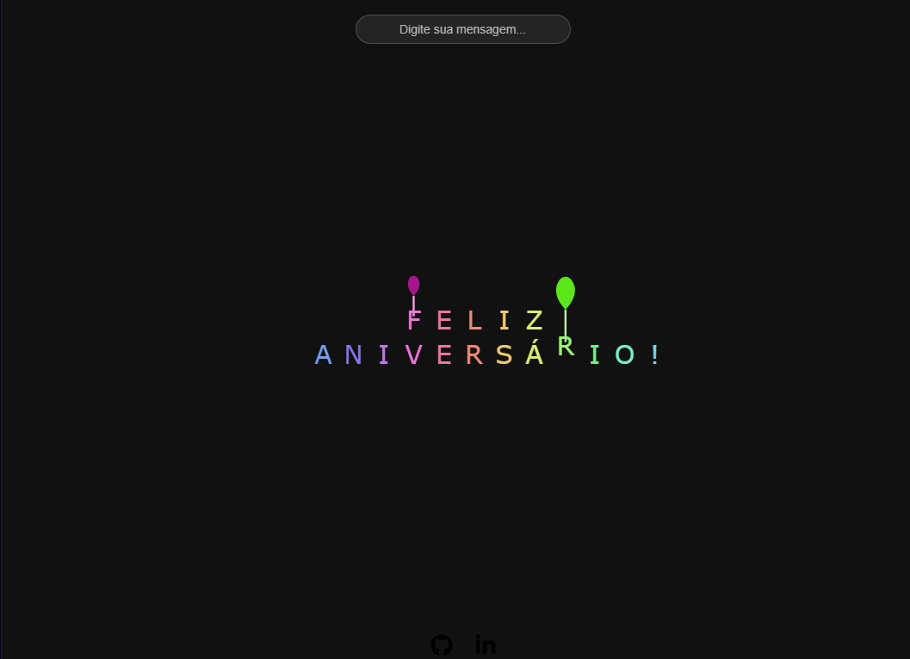

<div align="center">



<br><br>

# 🎆 Fireworks Message Generator

**Mensagens personalizadas transformadas em uma experiência de fogos de artifício.**

Uma experiência interativa criada com HTML, CSS, JavaScript e Canvas API — onde cada letra ganha vida com luz, partículas e movimento.

<p>
  
  
  
</p>

<p>
  <a href="https://paulapsox.github.io/fireworks-message-generator/">
    
  </a>
  <a href="https://github.com/paulaPSOx/fireworks-message-generator">
    
  </a>
</p>

</div>

---

## ✨ Sobre o projeto

O **Fireworks Message Generator** é uma animação visual interativa que transforma mensagens em um espetáculo de fogos de artifício.

A experiência começa com a mensagem **“FELIZ ANIVERSÁRIO!”**. Ao digitar um novo texto, as letras passam a ser animadas individualmente: foguetes são lançados, explodem em partículas luminosas e revelam os caracteres. Depois, balões aparecem, inflam e flutuam pela tela.

A interação não termina na mensagem: **um clique em qualquer ponto da tela também cria fogos adicionais**, permitindo explorar a animação livremente.

---

## 🎇 Experimente

<blockquote>
  <strong>Digite uma mensagem, observe a animação e clique na tela para criar mais fogos.</strong>
</blockquote>

- **Aplicação:** [Fireworks Message Generator](https://paulapsox.github.io/fireworks-message-generator/)
- **Código-fonte:** [GitHub Repository](https://github.com/paulaPSOx/fireworks-message-generator)

---

## 🌟 Funcionalidades

| Recurso | Descrição |
| :-- | :-- |
| ✍️ **Mensagem personalizada** | Digite uma frase no campo de texto para atualizar a animação. |
| 🔠 **Texto em maiúsculas** | A mensagem é convertida para letras maiúsculas. |
| 🎆 **Fogos animados** | Foguetes percorrem a tela e revelam as letras por meio de explosões. |
| ✨ **Partículas luminosas** | Partículas com movimento, gravidade e rastros compõem as explosões. |
| 🎈 **Balões** | Após a aparição das letras, balões são desenhados, inflam e sobem. |
| 🖱️ **Interação por clique** | Clique na área da animação para criar partículas de fogos extras. |
| 📱 **Layout adaptável** | Interface com ajustes para telas menores por meio de media queries. |

---

## 🎬 Como a animação acontece

Cada letra é controlada individualmente por uma sequência de fases:

<table>
  <tr>
    <td width="25%" align="center">
      <strong>01 · Lançamento</strong><br><br>
      🚀<br>
      <sub>O foguete parte da base e segue até a posição da letra, deixando um rastro luminoso.</sub>
    </td>
    <td width="25%" align="center">
      <strong>02 · Explosão</strong><br><br>
      🎆<br>
      <sub>O foguete chega ao destino e cria um círculo de explosão e partículas que se espalham.</sub>
    </td>
    <td width="25%" align="center">
      <strong>03 · Letra</strong><br><br>
      🔤<br>
      <sub>O caractere é revelado e permanece visível durante um intervalo da animação.</sub>
    </td>
    <td width="25%" align="center">
      <strong>04 · Balão</strong><br><br>
      🎈<br>
      <sub>Um balão surge, infla e sobe até sair da área visível.</sub>
    </td>
  </tr>
</table>

Ao finalizar a sequência, a animação é reiniciada, mantendo o espetáculo em movimento.

---

## 🧠 Por dentro da implementação

O projeto utiliza recursos nativos do navegador para construir a animação sem bibliotecas externas.

| Conceito | Aplicação |
| :-- | :-- |
| **Canvas API** | Desenho e atualização dos elementos visuais diretamente na tela. |
| **`requestAnimationFrame()`** | Loop contínuo para renderizar e atualizar as animações. |
| **Objetos e protótipos** | Cada letra e partícula possui estado e comportamento próprios. |
| **Física básica** | Velocidade, gravidade, deslocamento e trajetória das partículas. |
| **`Math.sin()` e `Math.cos()`** | Cálculo de trajetórias, direções e distribuição das partículas. |
| **Curvas Bézier** | Construção do formato dos balões. |
| **Eventos DOM** | Entrada de texto e cliques do usuário. |
| **Media queries** | Ajustes do campo de texto e ícones em diferentes larguras de tela. |

### Estados da animação

A lógica de cada caractere acompanha diferentes estados, como lançamento, contemplação da letra, balão e conclusão. As partículas também possuem seu próprio ciclo de vida e são removidas da animação quando deixam de estar ativas.

---

## 🛠️ Tecnologias

<div align="center">

<table>
  <tr>
    <td align="center" width="25%">
      <br>
      <strong>HTML5</strong><br>
      <sub>Estrutura</sub>
    </td>
    <td align="center" width="25%">
      <br>
      <strong>CSS3</strong><br>
      <sub>Estilização</sub>
    </td>
    <td align="center" width="25%">
      <br>
      <strong>JavaScript</strong><br>
      <sub>Lógica e interação</sub>
    </td>
    <td align="center" width="25%">
      <br>
      <strong>Canvas API</strong><br>
      <sub>Animação gráfica</sub>
    </td>
  </tr>
</table>

</div>

---

## 📱 Responsividade

O CSS possui ajustes para diferentes larguras de tela:

| Breakpoint | Adaptação |
| :-- | :-- |
| `768px` | Ajustes para tablets e telas menores. |
| `480px` | Campo de mensagem e espaçamentos adaptados para mobile. |
| `360px` | Ajustes adicionais para telas compactas. |

---

## 🚀 Como executar localmente

O projeto não utiliza frameworks, dependências ou ferramentas de build.

### 1. Clone o repositório

```bash
git clone https://github.com/paulaPSOx/fireworks-message-generator.git
```

### 2. Acesse a pasta

```bash
cd fireworks-message-generator
```

### 3. Abra a aplicação

Abra o arquivo `index.html` em um navegador moderno.

Se preferir, utilize o VS Code com a extensão Live Server para executar o projeto localmente.

---

## 📂 Estrutura do projeto

```text
fireworks-message-generator/
├── index.html
├── script.js
├── css/
│   └── style.css
├── img-fireworks-message-generator.png
├── imagens/
│   └── icones/
│       ├── github.svg
│       ├── linkedin-in.svg
│       └── icone.png
├── LICENSE
└── README.md
```

---

## 🎯 Objetivos e aprendizados

Este projeto foi uma oportunidade de praticar e explorar:

- Desenvolvimento de animações com Canvas API.
- Organização de lógica de animação por estados.
- Manipulação de partículas e efeitos visuais.
- Aplicação de conceitos de movimento e gravidade.
- Criação de desenhos com curvas Bézier.
- Manipulação de eventos de entrada e clique.
- Atualização de animações com `requestAnimationFrame()`.
- Estruturação de uma aplicação front-end sem bibliotecas externas.

---

## 🔮 Ideias para evoluções futuras

- [ ] Permitir controlar cores e efeitos dos fogos.
- [ ] Adicionar botão para pausar e retomar a animação.
- [ ] Melhorar o comportamento do texto para diferentes tamanhos de mensagem.
- [ ] Oferecer opções de velocidade e intensidade.
- [ ] Criar controles acessíveis para a experiência.

---

## 📄 Licença

Este projeto está licenciado sob a **MIT License**. Consulte o arquivo [`LICENSE`](./LICENSE) para mais detalhes.

---

<div align="center">

## 👩‍💻 Desenvolvido por Paula Oliveira

Projeto de portfólio desenvolvido para explorar a criatividade e praticar JavaScript, animações e interatividade no navegador.

<p>
  <a href="https://github.com/paulaPSOx">
    
  </a>
  <a href="https://www.linkedin.com/in/oliveiraspaula/">
    
  </a>
</p>

**Se gostou do projeto, deixe uma ⭐ no repositório!**

</div>
